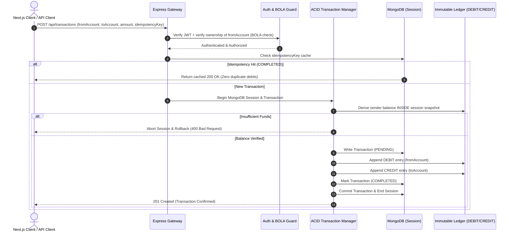

# 💳 Institutional Double-Entry Ledger Core

> Production-grade financial transaction engine and double-entry ledger platform with distributed idempotency, snapshot balance derivation, and ACID session guarantees.

[](https://nodejs.org)
[](https://nextjs.org)
[](https://typescriptlang.org)
[](https://tailwindcss.com)
[](https://mongodb.com)
[](https://opensource.org/licenses/MIT)

---

## 🎯 Executive Overview

Conventional CRUD banking implementations mutate balances directly (`balance -= amount`), introducing dangerous race conditions, balance drift, and audit failures under concurrent load.

This engine implements an **Institutional Double-Entry Accounting Core** modeled after systems at Stripe, Modern Treasury, and Brex.

### Core Architectural Invariants:
1. **Mathematical Equilibrium**: Every transfer generates equal, opposite, and atomic entries ($\sum \text{Debits} == \sum \text{Credits}$).
2. **Derived Balances**: Account balances are never stored as static fields; they are derived dynamically via aggregation pipelines over immutable historical entries.
3. **Strict Distributed Idempotency**: Network retries and duplicate submissions safely return cached transaction results without double-debiting.
4. **ACID Snapshot Isolation**: MongoDB multi-document transactions ensure atomic commits and instant rollbacks on validation failures.
5. **Zero BOLA Vulnerabilities**: Strict object-level authorization guarantees users can only transfer from accounts they own.

---

## 🏗️ System Architecture



---

## 📂 Project Structure

```
backend-ledger/
├── server.js                 # Express server entry point (PORT configurable)
├── package.json              # Backend dependencies (Express, Mongoose, JWT)
├── .env.example              # Sample environment configuration
├── run.bat / run.ps1         # 1-click backend launcher
├── run-frontend.bat / .ps1   # 1-click frontend launcher
├── src/
│   ├── app.js                # Express app setup, CORS, and route registration
│   ├── config/
│   │   └── db.js             # MongoDB connection manager
│   ├── controllers/
│   │   ├── auth.controllers.js       # Register, Login, Logout, /me
│   │   ├── account.controller.js     # Create, List, Balances, Statement, Faucet
│   │   └── transaction.controller.js # 10-step ACID transfer, Reconciliation
│   ├── middleware/
│   │   └── auth.middleware.js        # JWT verification, blacklist, system check
│   ├── Models/
│   │   ├── account.model.js          # Account schema + getBalance() pipeline
│   │   ├── ledger.model.js           # Immutable DEBIT/CREDIT entries + preventMod hook
│   │   ├── transaction.model.js      # Idempotent transaction state machine
│   │   ├── user.model.js             # User identity & bcrypt authentication
│   │   └── blackList.model.js        # Revoked JWT token registry
│   ├── routes/
│   │   ├── auth.routes.js
│   │   ├── account.routes.js
│   │   └── transaction.routes.js
│   └── services/
│       └── email.service.js          # Transactional email notification service
└── frontend/                         # Next.js 15 (TypeScript) Application
    ├── package.json
    ├── tsconfig.json
    ├── next.config.js                # Automatic /api/* proxy to Express
    ├── tailwind.config.js            # Minimalist FinTech theme (Mercury/Linear style)
    └── src/
        ├── app/
        │   ├── layout.tsx            # Theme + Global Context Provider
        │   ├── page.tsx              # Overview & Account Balances
        │   ├── accounts/page.tsx     # Account Provisioning & Management
        │   ├── transfers/page.tsx    # Move Money & Concurrency Guard Drawer
        │   ├── ledger/page.tsx       # Immutable Ledger & CSV Export
        │   └── reconciliation/page.tsx # Trial Balance & Invariant Verification
        ├── components/
        │   ├── Navbar.tsx            # Clean header with Dark/Light toggle
        │   ├── AuthModal.tsx         # Sign in / Register modal
        │   ├── FaucetModal.tsx       # Sandbox fund injection
        │   └── Toast.tsx             # System notifications
        ├── context/
        │   ├── ThemeContext.tsx      # Persistent Dark/Light theme state
        │   └── LedgerContext.tsx     # Global application state
        ├── lib/
        │   └── api.ts                # Type-safe API client & UUID generator
        └── types/
            └── ledger.ts             # Strict TypeScript data models
```

---

## 🚀 Quickstart Guide

### 1. Configure Environment
Create a `.env` in the root directory:
```env
PORT=3000
NODE_ENV=development
MONGO_URI=mongodb+srv://<user>:<password>@cluster0.example.mongodb.net/ledger?retryWrites=true&w=majority
JWT_SECRET=super_secret_production_key_ledger_2026
```

### 2. Start the Backend API (Port 3000)
```bash
npm install
npm run dev
```
*(Or double-click `run.bat` / run `.\run.ps1`)*

### 3. Start the Next.js Frontend (Port 3001)
```bash
cd frontend
npm install
npm run dev
```
*(Or double-click `run-frontend.bat` / run `.\run-frontend.ps1`)*

Open **`http://localhost:3001`** in your browser.

---

## 📡 Core API Reference

| Method | Endpoint | Description |
| :--- | :--- | :--- |
| `POST` | `/api/auth/register` | Register a new user |
| `POST` | `/api/auth/login` | Authenticate user & issue JWT |
| `POST` | `/api/auth/logout` | Invalidate token and clear cookie |
| `GET` | `/api/auth/me` | Fetch authenticated session profile |
| `POST` | `/api/accounts/` | Provision new ledger account |
| `GET` | `/api/accounts/` | List user accounts with derived balances |
| `GET` | `/api/accounts/:id/statement` | Fetch chronological ledger audit trail |
| `POST` | `/api/accounts/faucet` | Deposit sandbox test funds via Central Settlement |
| `POST` | `/api/transactions/` | Execute double-entry transfer with ACID session |
| `GET` | `/api/transactions/reconciliation` | Verify system invariant ($\sum C - \sum D = 0$) |
| `GET` | `/api/transactions/recent` | List latest committed platform transactions |

---

## 📄 License
MIT License.
